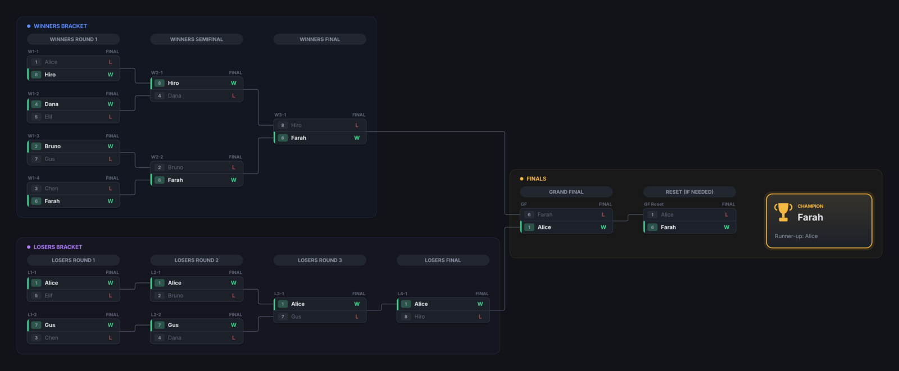

# Elo Calculator

A Windows desktop app for tracking player skill with **Elo ratings** and running **double-elimination tournaments**. Add your players, record who beat whom, and the app keeps a ranked leaderboard. When it's time for a tournament, it seeds a bracket from those ratings and draws it as an interactive chart you can pan, zoom and click through.

It works well for game nights, office leagues, esports clubs, chess or table-tennis ladders: anything where people play one-on-one and you want fair rankings.



## Features

### Ratings
- **Leaderboard** of every player, ranked by rating, with wins, losses, games played, win % and average opponent rating.
- **Record Match**: pick the winner and loser. Before you save, it shows how likely the win was and how many points each player will gain or lose.
- **Match History**: every game is logged. You can undo any game, not just the latest, and both players' ratings are reversed exactly.
- Uses the standard Elo formula with a K-factor of 32. Everyone starts at 1000.

### Double-elimination brackets
- **Seeding** from your players. Seed by rating, shuffle, or set the order by hand. Any number of players from 2 up works. Brackets are padded to the next power of two, and the byes go to the top seeds.
- **Proper double-elimination structure**: a winners bracket, a losers bracket with the usual drop-down rounds (ordered to avoid early rematches), a grand final, and a **reset match** that is played only if the losers-bracket champion wins the first grand final.
- **Visual bracket**:
  - Each round is a column, with connector lines showing who advances where.
  - Winners, losers and finals sections are colour-coded.
  - Matches that are ready to play are highlighted.
  - The champion gets a trophy card at the end.
- **Easy navigation**:
  - Drag to pan, scroll to move, and Ctrl+scroll to zoom.
  - A **minimap** shows the whole bracket; click it to jump anywhere.
  - Buttons jump straight to the Winners, Losers or Finals section, or to the **Next Match**.
  - Hover over a player to **trace their path** through the bracket.
  - Keyboard shortcuts: arrow keys / PageUp / PageDown pan, `+`/`-` zoom, `0` is 100%, `F` fits the bracket to the window, `Home` returns to the start.
- **Reporting results**: click a match and choose the winner. You can clear a result as long as no later match depends on it, or use **Undo** to step back.
- **Rated or casual**: optionally feed every bracket result into the Elo ratings. Undoing a bracket result also reverses its rating change.
- **Export PNG** saves a high-resolution image of the bracket for sharing.

### Saving
Everything saves automatically after each change, and files are written safely so a crash can't corrupt them.

| What | Where |
| --- | --- |
| Player list and match history | `Documents\Player Lists\players.xml` |
| Brackets (one file each) | `Documents\Player Lists\Brackets\` |

Use **Open Player List…** and **Save Player List As…** in the sidebar to keep separate lists, for example one per league. Player lists saved by version 1 of the app (including `person.txt`) open without any conversion.

## Getting started

### Requirements
- Windows 10 or 11
- To build: the [.NET 10 SDK](https://dotnet.microsoft.com/download), or Visual Studio 2026 with the *.NET desktop development* workload

### Build and run
```bash
git clone https://github.com/CFLChrisR/EloCalculator.git
```

```bash
cd EloCalculator
```

```bash
dotnet run --project src/EloCalculator --framework net10.0-windows
```

Or open `EloCalculator.sln` in Visual Studio and press F5.

The app is built for two frameworks:
- `net10.0-windows`: the main build.
- `net48`: runs on any Windows PC with .NET Framework 4.8, which ships with Windows 10 and 11, so nothing extra has to be installed.

### Run the tests
```bash
dotnet test
```

The tests cover the rating maths, the player list, file compatibility, and the bracket engine. The bracket tests play out random tournaments for every field size from 2 to 40 players.

## Project layout

```
EloCalculator.sln
├── src/
│   ├── EloCalculator.Core/      # UI-free logic (netstandard2.0)
│   │   ├── Players/             # Player, PlayerRoster, MatchRecord
│   │   ├── Rating/              # EloRatingCalculator
│   │   ├── Brackets/            # DoubleEliminationBracket, Tournament, seeding, file format
│   │   └── Storage/             # XmlStore (safe XML load/save)
│   └── EloCalculator/           # Windows Forms app
│       ├── UI/Pages/            # Leaderboard, Record Match, History, Bracket
│       └── UI/Bracket/          # BracketLayout, BracketRenderer, BracketView (pan/zoom/minimap)
├── tests/EloCalculator.Core.Tests/
└── samples/legacy-players.xml   # a file from v1, used to test backwards compatibility
```

All the rules live in `EloCalculator.Core`, which has no UI code and is fully unit-tested. The Windows Forms project only displays that state.

## How the rating works

For a player rated *R<sub>A</sub>* against an opponent rated *R<sub>B</sub>*, the expected score is

```
E = 1 / (1 + 10^((R_B − R_A) / 400))
```

The winner gains `K × (1 − E)` points, rounded and always at least 1, and the loser loses the same amount. So beating a stronger player earns more than beating a weaker one. With K = 32, two equally rated players swing 16 points.
